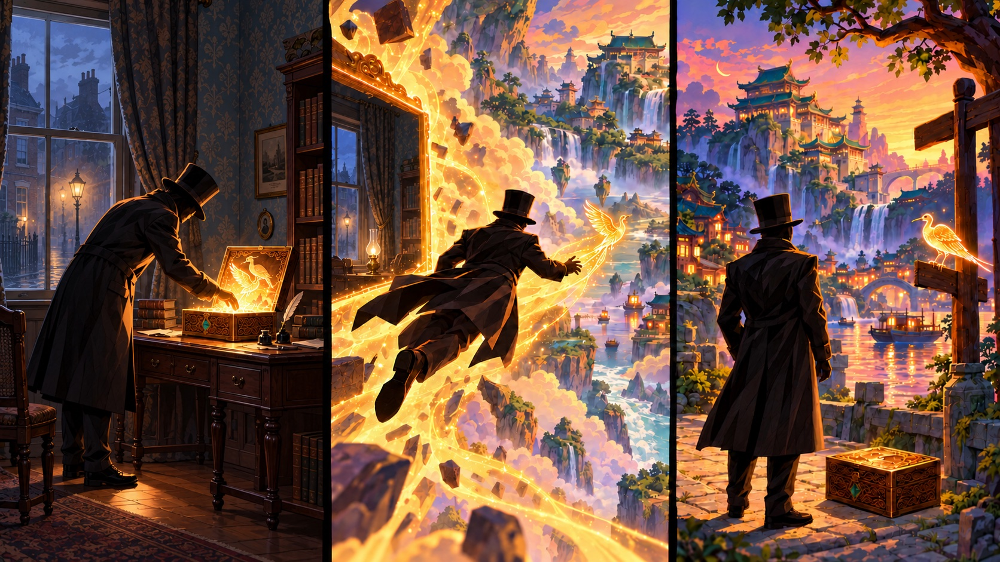

# The Lantern Table

For years, the walnut box had sat on the traveler's shelf, holding nothing but a few keepsakes.

Then, one evening, a bird began singing inside it.

The traveler set aside a leather-bound book and cleared a space on the mahogany writing desk. An oil lamp cast a small circle of light across the worn wood; beyond it, faded floral wallpaper disappeared into the shadows of the study. Beneath a layer of dust, the walnut lid was warm. Its carved feathers shifted under their fingers. When the clasp lifted, lamplight fell into a depth that should have ended at the bottom of a shallow tray.

Far below, a river curved around a city of green roofs.

The traveler leaned closer. Somewhere in that impossible distance, people were laughing around a table. It had been a long time since a room had sounded so inviting.

A small golden bird rose from the box and circled the traveler. Then it dipped back toward the landscape inside, pausing above the river to look up at them. When they stepped away, it returned to the rim and called again.

The traveler glanced at the window. Outside, a gas lamp lit the familiar cobbled street beneath the sash window. Whatever country they could see inside the box, it was somewhere else entirely.

They fetched a black coat and a tall black hat, then stood beside the desk and bent over the box, holding a hand above the opening. The bird descended a little way and waited.

Their fingers followed it below the rim. They reached farther than the box was deep, yet touched no wood. Warm air stirred their sleeve. The traveler paused, took one last look around the room, and leaned toward the waiting bird.

A gentle current lifted their feet from the floor. The opening widened around their shoulders, and the desk slipped out of sight as they passed through the box. Golden light surrounded them. Ahead, the bird flew down a luminous passage, slowing whenever they drifted behind.

Then their shoes met stone. They stood on a path beside an unfamiliar river, facing the green-roofed city they had seen from the desk. Their room was gone. They had crossed into another world.

At their feet lay the walnut box, closed again. The traveler picked it up and checked the clasp. The bird waited on a nearby signpost until they were ready, then fluttered toward the city, returning whenever they hesitated at a turning.

Following their guide into the streets, they found a festival ending. Shopkeepers gathered their awnings. Children carried painted game pieces almost as large as their hands. Through an open doorway, an elderly woman celebrated a victory while her opponent demanded that she explain it again, more slowly.

The traveler lingered there, smiling beneath the brim.

The golden bird flew on toward a grand pavilion beside the water, its high roof supported by jade columns wound with gilded dragons. At its door, the guide slipped back beneath the walnut lid, leaving a warm glow along the seam.

Inside, King Poon was trying to persuade Minister Shen to sit down.

“You've been carrying that ledger since breakfast.”

“And you have been avoiding it since breakfast.”

Poon pushed a cup toward the empty chair. Shen laid the ledger on the seat instead of sitting down.

The king sighed.

Behind Poon, an empty jade throne stood on a raised dais, its back crowned by two carved green dragons facing inward. He had left it to sit at one of the game tables beneath the tall columns, where he could speak to his guests without making them look up. Lanternlight gleamed on the polished green floor and reflected in the river beyond the arched windows. He had opened this royal pavilion so anyone could come in for a game, and on most evenings every table filled. He liked the noise. Sometimes, when a close match drew a crowd, he could almost hear the arena he had left behind.

Tonight the last players had gone home. Poon was gathering the cards when the door opened.

The stranger stood on the threshold, dressed in black from collar to shoes. A top hat shaded their face. In their arms, a wooden box glimmered along its seams.

“Forgive me. Where have I come to?” they asked.

Poon looked at the box.

A thread of gold escaped the lid and hung briefly in the air. He knew that light. It had opened above a basketball rim, swallowed the roar of a crowd, and delivered him to a throne he had never asked for.

Then the thread curled into a little bird, and the memory loosened its grip.

He moved Shen's ledger to another table.

“The riverside game hall,” he said, drawing out the chair. “In the Poon Kingdom. You look as though you've had a journey.”

The visitor sat opposite him, near a great hearth framed in carved jade. As they opened the box, its glow climbed the stonework. The flames framed jade towers and distant mountains washed in late afternoon gold, though night had already fallen outside. The view lingered as the visitor set the open box beside the board.

Shen checked the window beside him, then the hearth. He quietly reached for his brush.

“Was there an opening like that where you came from?” Poon asked, nodding toward the hearth.

“I followed that bird into the box.” The visitor looked down at the small wooden object beside them. “There was a passage inside. It brought me out by the river, and the bird led me here.”

“I didn't get much warning either,” Poon said. “One moment I was going up for a dunk. The next, I was sitting in a palace with everyone calling me king.”

The stranger looked at his crown, then the basketball jersey beneath his cloak. “That explains part of the outfit.”

Poon laughed. The stranger's shoulders relaxed.

Between them lay bird cards, speckled eggs, and a small wooden feeder. The visitor reached toward one of the cards, then stopped just short of touching it.

They studied the bird illustrations and traced a familiar symbol with one finger. “I used to play this. I haven't seen it in years.”

Poon slid the deck closer.

“Would you like a game? We can work out the rest over tea.”

The visitor hesitated, then removed their gloves. “I think I'd like that.”

Their hands grew surer as they worked. Soon the visitor was correcting the position of a token and explaining a detail Poon had overlooked. He listened, turning the piece between his fingers. Whoever sat beneath that hat had played more than a few games.

Shen cleared his throat.

“For the hall's register, may I have your name?”

The stranger's hand paused over the pieces. They had followed a bird into a country they had never heard of; giving their name to a royal official felt like another step they were not quite ready to take.

“Could that wait?”

Poon nodded to the minister. Shen left the line empty.

Shen poured fresh tea, then carried his ledger to a desk across the room. Poon dealt the cards. The little bird hovered above the open box, lighting the edges of their hands.

For the first few turns, Poon reminded the visitor of the choices available. Their memory returned in fragments: a symbol, then a familiar combination. When they named the bird they wanted to play, its card slid gently into place. They drew back their hand, startled, then laughed.

“That would have saved me a great deal of reaching.”

Soon, small birds occupied the painted landscape, and speckled eggs gathered beside the cards. Dice rattled through the wooden feeder. The visitor's pauses grew shorter. Once, they started to ask a question, looked again, and found the answer themselves.

Poon recognized the pleasure in that small discovery. He had felt it here too, when the patterns on a game board began to make as much sense as players moving across a basketball court.

Poon glanced twice at a bird in the face-up row between them. Before his next turn came, his guest reached for it.

Poon leaned forward, resting his chin against one hand. Beneath the black hat, the stranger kept their face lowered, but their fingers lingered on the card just long enough to suggest they knew exactly what they had done.

“You were watching that one,” they said.

“I was.”

“Shall I give you a moment?”

He gave a short laugh and studied the board again.

Above the box, the golden bird spread its wings. The hearth still shone with the light of another afternoon, and neither player had touched their tea in several turns. Across the room, Shen glanced up from the unfinished register, heard the king laugh, and left the name unwritten.
